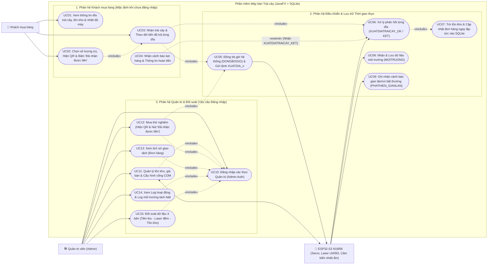
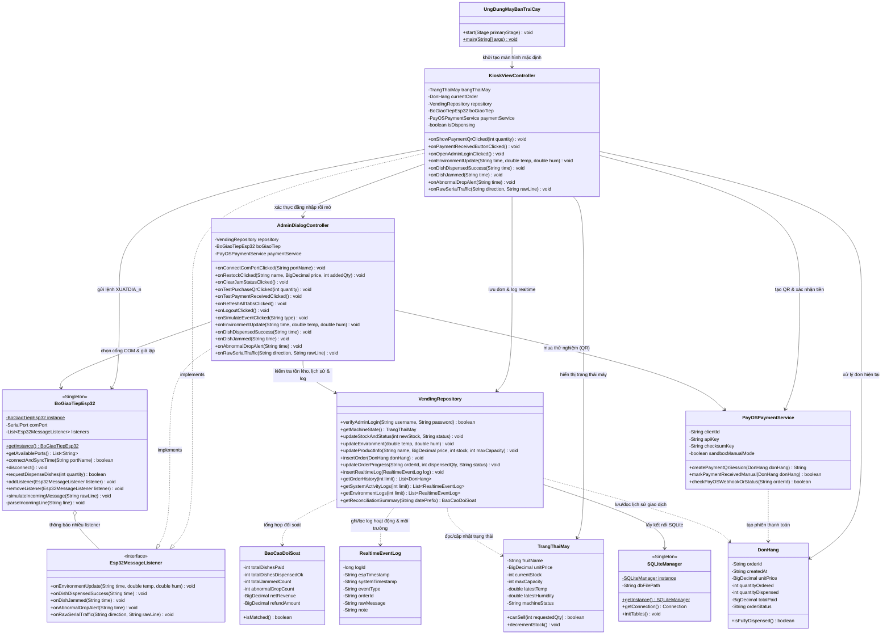
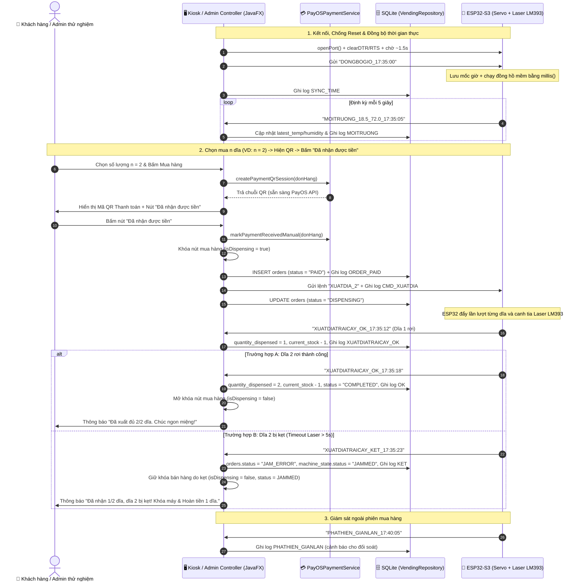

# KẾ HOẠCH THIẾT KẾ HỆ THỐNG: MÁY BÁN TRÁI CÂY TỰ ĐỘNG (KẾT HỢP ESP32-S3 & JAVAFX)

> **Tài liệu chốt thiết kế (Design Blueprint):** Tài liệu này quy định toàn bộ kiến trúc, cấu trúc thư mục, thiết kế cơ sở dữ liệu, giao thức truyền thông USB, xác thực quản trị, dịch vụ thanh toán sẵn sàng cho PayOS và lộ trình triển khai cho đồ án cuối kỳ môn Lập trình Java. Mọi quá trình viết code sau này phải tuân thủ đúng các quy ước trong tài liệu này.

---

## TỔNG QUAN SƠ ĐỒ NGHIỆP VỤ (USE CASE DIAGRAM)

Hệ thống được phân tách trách nhiệm rõ ràng theo nguyên lý **Trừu tượng hóa phần cứng (Hardware Abstraction)**:
- **Phần mềm JavaFX + SQLite:** Mặc định khi mở ứng dụng (chưa đăng nhập) sẽ hiển thị giao diện **Kiosk dành cho người mua hàng**. Muốn vào trang **Quản trị (`AdminDialog`)** bắt buộc phải qua bước **đăng nhập xác thực**. Phần mềm đảm nhiệm giao diện Kiosk/Admin, tạo QR thanh toán (tách riêng trong `PayOSPaymentService`), lưu trữ dữ liệu thời gian thực và đối soát 3 bên.
- **Phần cứng ESP32-S3 N16R8:** Tự trị hoàn toàn trong việc điều khiển động cơ Servo, quản lý đồng hồ mềm, canh thời gian và đọc cảm biến **Diode Laser + Quang trở LM393** cùng cảm biến nhiệt độ/độ ẩm để báo kết quả cuối cùng về Java.



---

## 1. Tech Stack & Phiên bản (Công nghệ sử dụng)

| Thành phần | Công nghệ / Thư viện | Phiên bản chốt | Vai trò trong hệ thống |
| :--- | :--- | :--- | :--- |
| **Ngôn ngữ & JDK** | Java (JDK) | **Java 17 LTS** (tương thích JDK 17/21 LTS) | Ngôn ngữ lập trình chính của toàn bộ phần mềm |
| **Thư viện Giao diện (UI)** | **JavaFX** (`javafx-controls`, `javafx-fxml`) | **21.0.2** | Xây dựng giao diện Kiosk khách hàng & cửa sổ Quản trị/Đối soát bằng FXML + CSS |
| **Công cụ Build & Quản lý** | **Apache Maven** (`pom.xml`) + `javafx-maven-plugin` | Maven 3.x / Plugin **0.0.8** | Quản lý thư viện phụ thuộc và chạy ứng dụng qua lệnh `mvn javafx:run` |
| **Cơ sở dữ liệu (Database)** | **SQLite 3** (`org.xerial:sqlite-jdbc`) | **3.45.1.0** | Lưu toàn bộ dữ liệu vào file cục bộ `vending_machine.db` (chế độ `WAL` + `busy_timeout=5000`, lưu thời gian thực phục vụ đối soát) |
| **Giao tiếp Phần cứng (USB)** | **jSerialComm** (`com.fazecast:jSerialComm`) | **2.10.4** | Truyền nhận bản tin UART qua cổng COM USB với ESP32-S3 ở tốc độ Baudrate `115200` |
| **Tạo mã QR Thanh toán** | **ZXing** (`com.google.zxing:core` & `javase`) | **3.5.3** | Sinh ảnh mã QR thanh toán trực tiếp trên JavaFX từ chuỗi QR (sẵn sàng nhận chuỗi QR từ PayOS API sau này) |
| **Vi điều khiển & Cảm biến** | **ESP32-S3 N16R8** (Arduino C++) | - | Quản lý 01 khay (1 cột) Servo, 01 cặp **Diode Laser + Quang trở LM393**, 01 cảm biến nhiệt ẩm DHT11/DHT22 |

---

## 2. Cấu trúc thư mục chuẩn (Project Structure)

Project tổ chức theo mô hình phân tầng chuẩn Maven kết hợp kiến trúc **MVC + Service + DAO/Repository + Hardware Abstraction**:

```text
bantraicay/
├── PLAN.md                                      # Tài liệu chốt thiết kế hệ thống
├── pom.xml                                      # Cấu hình Maven & Dependencies
├── vending_machine.db                           # File CSDL SQLite (tự động khởi tạo khi chạy app)
├── esp32_firmware/                              # Code nhúng cho mạch ESP32-S3 N16R8
│   └── esp32_vending_controller.ino
└── src/
    └── main/
        ├── java/
        │   └── com/
        │       └── bantraicay/
        │           ├── UngDungMayBanTraiCay.java            # Điểm khởi chạy ứng dụng JavaFX
        │           ├── model/                               # Tầng Entity & DTO
        │           │   ├── TrangThaiMay.java                # Trạng thái máy & tồn kho 1 khay
        │           │   ├── DonHang.java                     # Đơn hàng / Hóa đơn mua trái cây
        │           │   ├── RealtimeEventLog.java            # Nhật ký sự kiện thời gian thực
        │           │   └── BaoCaoDoiSoat.java               # DTO tổng hợp báo cáo đối soát
        │           ├── hardware/                            # Tầng Giao tiếp USB Serial với ESP32
        │           │   ├── Esp32MessageListener.java        # Interface lắng nghe sự kiện từ ESP32
        │           │   └── BoGiaoTiepEsp32.java            # Singleton quản lý cổng COM, danh sách listener & parse lệnh
        │           ├── dao/                                 # Tầng Truy xuất CSDL SQLite
        │           │   ├── SQLiteManager.java               # Singleton quản lý kết nối (WAL/timeout) & tạo bảng SQLite
        │           │   └── VendingRepository.java           # Thực thi SQL synchronized lưu đơn, trừ kho, log, auth & đối soát
        │           ├── service/                             # Tầng Dịch vụ Nghiệp vụ & Thanh toán
        │           │   └── PayOSPaymentService.java         # Service tạo QR & tích hợp PayOS API (hiện tại hỗ trợ QR + nút 'Đã nhận được tiền')
        │           └── controller/                          # Tầng Điều khiển Giao diện JavaFX
        │               ├── KioskViewController.java         # Controller màn hình Kiosk bán hàng (mặc định)
        │               └── AdminDialogController.java       # Controller màn hình Quản trị & Đối soát (sau đăng nhập)
        └── resources/
            └── com/
                └── bantraicay/
                    ├── css/
                    │   └── style.css                        # Giao diện CSS cho Kiosk & Admin
                    ├── images/
                    │   └── fruit_plate.png                  # Hình ảnh minh họa dĩa trái cây
                    └── view/
                        ├── KioskView.fxml                   # Bố cục màn hình Kiosk Khách mua hàng
                        └── AdminDialog.fxml                 # Bố cục cửa sổ Quản trị & Đối soát
```

---

## 3. Thiết kế Dữ liệu & Class (Database Schema & Class Design)

### 3.1. Thiết kế Cơ sở dữ liệu SQLite (`vending_machine.db`)

CSDL gồm **4 bảng** chuẩn hóa cho mô hình máy bán trái cây 1 khay, xác thực quản trị và lưu vết đối soát thời gian thực:

#### Bảng 1: `machine_state` (Lưu cấu hình & trạng thái hiện tại của khay trái cây duy nhất)
> Ràng buộc chỉ có duy nhất 1 dòng dữ liệu (`id = 1`).

| Tên cột | Kiểu dữ liệu SQLite | Ràng buộc (Constraints) | Mô tả |
| :--- | :--- | :--- | :--- |
| `id` | `INTEGER` | `PRIMARY KEY CHECK (id = 1)` | Khóa chính cố định bằng `1` |
| `fruit_name` | `TEXT` | `NOT NULL` | Tên loại dĩa trái cây đang bán (VD: *Dĩa Trái Cây Tươi Mix*) |
| `unit_price` | `NUMERIC` | `NOT NULL` | Đơn giá 1 dĩa (VNĐ) |
| `current_stock` | `INTEGER` | `NOT NULL CHECK (current_stock >= 0)` | Số lượng dĩa hiện còn trong khay |
| `max_capacity` | `INTEGER` | `NOT NULL` | Sức chứa tối đa của cột chứa dĩa |
| `latest_temp` | `REAL` | `DEFAULT 0.0` | Nhiệt độ buồng máy mới nhất (°C) |
| `latest_humidity` | `REAL` | `DEFAULT 0.0` | Độ ẩm buồng máy mới nhất (%) |
| `machine_status` | `TEXT` | `NOT NULL` | Trạng thái máy: `READY`, `JAMMED`, `OUT_OF_STOCK`, `OVERHEAT` |
| `updated_at` | `TEXT` | `NOT NULL` | Thời điểm cập nhật gần nhất (`yyyy-MM-dd HH:mm:ss.SSS`) |

#### Bảng 2: `orders` (Lưu hóa đơn và tiến độ xuất từng dĩa thực tế)

| Tên cột | Kiểu dữ liệu SQLite | Ràng buộc (Constraints) | Mô tả |
| :--- | :--- | :--- | :--- |
| `order_id` | `TEXT` | `PRIMARY KEY` | Mã đơn hàng duy nhất (VD: `ORD-20261118-173500` hoặc `TEST-20261118-173500`) |
| `created_at` | `TEXT` | `NOT NULL` | Thời điểm khách/admin bấm xác nhận thanh toán (`yyyy-MM-dd HH:mm:ss.SSS`) |
| `unit_price` | `NUMERIC` | `NOT NULL` | Đơn giá 1 dĩa tại thời điểm mua (lưu lịch sử giá) |
| `quantity_ordered` | `INTEGER` | `NOT NULL CHECK (quantity_ordered > 0)` | Số lượng dĩa đã đặt & trả tiền ($n$) |
| `quantity_dispensed` | `INTEGER` | `NOT NULL DEFAULT 0` | Số dĩa thực tế đã rơi qua tia Laser (`XUATDIATRAICAY_OK`) |
| `total_paid` | `NUMERIC` | `NOT NULL` | Tổng số tiền đã thanh toán (`unit_price * quantity_ordered`) |
| `order_status` | `TEXT` | `NOT NULL` | Trạng thái đơn: `PAID`, `DISPENSING`, `COMPLETED`, `JAM_ERROR` |

#### Bảng 3: `realtime_event_logs` (Nhật ký thời gian thực phục vụ phân tách Log Hoạt động & Log Môi trường)

| Tên cột | Kiểu dữ liệu SQLite | Ràng buộc (Constraints) | Mô tả |
| :--- | :--- | :--- | :--- |
| `log_id` | `INTEGER` | `PRIMARY KEY AUTOINCREMENT` | Khóa chính tự tăng theo thứ tự sự kiện phát sinh |
| `system_timestamp` | `TEXT` | `NOT NULL` | Thời gian Laptop ghi log (`yyyy-MM-dd HH:mm:ss.SSS`) |
| `esp_timestamp` | `TEXT` | `NULL` | Thời gian `hh:mm:ss` do ESP32 gửi kèm trong bản tin |
| `event_type` | `TEXT` | `NOT NULL` | Loại sự kiện: `ORDER_PAID`, `CMD_XUATDIA`, `XUATDIATRAICAY_OK`, `XUATDIATRAICAY_KET`, `PHATHIEN_GIANLAN`, `MOITRUONG`, `ADMIN_LOGIN`, `ADMIN_RESTOCK`, `SYNC_TIME` |
| `order_id` | `TEXT` | `NULL` | Mã đơn hàng liên quan (hoặc `NULL` nếu là log môi trường/đăng nhập/gian lận) |
| `raw_message` | `TEXT` | `NULL` | Chuỗi thông điệp thô truyền/nhận qua USB Serial |
| `note` | `TEXT` | `NULL` | Ghi chú chi tiết phục vụ kiểm tra & đối soát |

#### Bảng 4: `admin_accounts` (Lưu tài khoản xác thực Quản trị viên)

| Tên cột | Kiểu dữ liệu SQLite | Ràng buộc (Constraints) | Mô tả |
| :--- | :--- | :--- | :--- |
| `username` | `TEXT` | `PRIMARY KEY` | Tên tài khoản đăng nhập quản trị (mặc định khởi tạo `admin`) |
| `password_hash` | `TEXT` | `NOT NULL` | Mật khẩu xác thực đã băm SHA-256 (mặc định khởi tạo tương ứng `admin123`) |
| `last_login_at` | `TEXT` | `NULL` | Thời điểm đăng nhập quản trị thành công gần nhất |

---

### 3.2. Sơ đồ Lớp (UML Class Diagram) & Chi tiết 12 Class/Interface



#### Mô tả chi tiết từng Class/Interface:

1. **Tầng Model (`com.bantraicay.model`):**
   - **`TrangThaiMay`**: Ánh xạ bảng `machine_state`. Chứa thông tin sản phẩm (`fruitName`, `unitPrice`), tồn kho (`currentStock`, `maxCapacity`), dữ liệu cảm biến (`latestTemp`, `latestHumidity`), trạng thái (`machineStatus`). Hàm `canSell(int requestedQty)` kiểm tra máy ở trạng thái `READY` và `requestedQty > 0 && requestedQty <= currentStock`; `decrementStock()` trừ 1 khi dĩa rơi thành công.
   - **`DonHang`**: Ánh xạ bảng `orders`. Chứa `orderId`, `createdAt`, `unitPrice` (`BigDecimal`), `quantityOrdered`, `quantityDispensed`, `totalPaid` (`BigDecimal`), `orderStatus`. Hàm `isFullyDispensed()` trả về `true` khi `quantityDispensed == quantityOrdered`.
   - **`RealtimeEventLog`**: Ánh xạ bảng `realtime_event_logs`. Chứa `logId` (`long`), `espTimestamp` (`String`), `systemTimestamp` (`String`), `eventType`, `orderId`, `rawMessage`, `note`.
   - **`BaoCaoDoiSoat`**: Lớp DTO tổng hợp kết quả đối soát: `totalDishesPaid`, `totalDishesDispensedOk`, `totalJammedCount`, `abnormalDropCount`, `netRevenue` (`BigDecimal`), `refundAmount` (`BigDecimal`). Hàm `isMatched()` kiểm tra tính khớp dữ liệu (số lượng trả tiền = số lượng Laser đếm và không có cảnh báo gian lận).

2. **Tầng Hardware (`com.bantraicay.hardware`):**
   - **`Esp32MessageListener` (`interface`)**: Áp dụng **Observer Pattern** gồm 5 callback: `onEnvironmentUpdate(time, temp, hum)`, `onDishDispensedSuccess(time)`, `onDishJammed(time)`, `onAbnormalDropAlert(time)`, `onRawSerialTraffic(direction, rawLine)`.
   - **`BoGiaoTiepEsp32` (`<<Singleton>>`)**:
     - Quản lý duy nhất 1 kết nối `SerialPort` (`jSerialComm`) ở tốc độ `115200` bps và lưu danh sách **`List<Esp32MessageListener> listeners`** (dùng `CopyOnWriteArrayList` kết hợp `addListener()` / `removeListener()`) để cả màn hình Kiosk và cửa sổ Admin đều nhận được sự kiện song song mà không ghi đè mất nhau.
     - Trong `connectAndSyncTime(portName)`: Sau khi `openPort()`, gọi **`comPort.clearDTR(); comPort.clearRTS();`** và chờ khoảng **`1500ms`** (tránh thời gian ESP32-S3 tự reset do mạch nạp USB-UART) rồi mới gửi lệnh `DONGBOGIO_hh:mm:ss\n`.
     - Trong `parseIncomingLine(line)`: Luôn gọi **`.trim()`** để loại bỏ ký tự `\r` từ `Serial.println()` bên ESP32 trước khi `.split("_")`.
     - Cung cấp thêm `requestDispenseDishes(quantity)` (gửi `XUATDIA_n`) và `simulateIncomingMessage(rawLine)` phục vụ test khi chưa cắm mạch thật.

3. **Tầng DAO (`com.bantraicay.dao`):**
   - **`SQLiteManager` (`<<Singleton>>`)**: Quản lý đường dẫn file `vending_machine.db`, chạy `initTables()` tạo **4 bảng** (`machine_state`, `orders`, `realtime_event_logs`, `admin_accounts`) cùng dữ liệu mẫu khay hàng và tài khoản quản trị mặc định (`admin` / `admin123`) nếu chưa tồn tại. Trong `getConnection()`, luôn cấu hình **`PRAGMA journal_mode=WAL;`** và **`PRAGMA busy_timeout=5000;`** để cho phép đọc/ghi đồng thời ổn định, chống lỗi `SQLITE_BUSY`.
   - **`VendingRepository`**: Thực hiện toàn bộ truy vấn SQL, với toàn bộ hàm ghi được khai báo **`synchronized`**:
     - Xác thực quản trị: `verifyAdminLogin(username, password)`.
     - Trạng thái & kho: `getMachineState()`, `updateStockAndStatus()`, `updateEnvironment()`, `updateProductInfo()`.
     - Đơn hàng & lịch sử: `insertOrder()`, `updateOrderProgress()`, `getOrderHistory(limit)`.
     - Nhật ký & Đối soát tách biệt: `insertRealtimeLog()`, `getSystemActivityLogs(limit)` (lọc `event_type != 'MOITRUONG'`), `getEnvironmentLogs(limit)` (lọc `event_type = 'MOITRUONG'`), `getReconciliationSummary(datePrefix)`.

4. **Tầng Dịch vụ Thanh toán (`com.bantraicay.service`):**
   - **`PayOSPaymentService`**: Tách riêng toàn bộ nghiệp vụ thanh toán để chuẩn bị sẵn sàng tích hợp **PayOS API**:
     - Lưu cấu hình `clientId`, `apiKey`, `checksumKey` và cờ chế độ `sandboxManualMode`.
     - `createPaymentQrSession(DonHang donHang)`: Tạo nội dung mã QR thanh toán (chứa mã đơn, số tiền, nội dung chuyển khoản) và dùng thư viện ZXing hiển thị lên UI. Khi gắn PayOS API thật về sau, hàm này chỉ cần gọi endpoint tạo Payment Link của PayOS và trả về chuỗi `qrCode` từ PayOS.
     - `markPaymentReceivedManual(DonHang donHang)`: Hỗ trợ chế độ hiện tại cho phép người dùng/Admin bấm nút **"Đã nhận được tiền"** để xác nhận giao dịch hợp lệ.
     - `checkPayOSWebhookOrStatus(String orderId)`: Hàm chờ sẵn để sau này polling hoặc nhận trạng thái thanh toán tự động từ PayOS API mà không làm thay đổi giao diện hay Controller.

5. **Tầng Controller & UI (`com.bantraicay.controller` & `UngDungMayBanTraiCay`):**
   - **`UngDungMayBanTraiCay`**: Kế thừa `javafx.application.Application`, gọi `SQLiteManager.getInstance().initTables()`, tải `KioskView.fxml` làm màn hình mặc định (chưa đăng nhập) và đóng cổng COM an toàn khi thoát app.
   - **`KioskViewController`**: Implements `Esp32MessageListener` và đăng ký qua `addListener()`. Quản lý chọn số lượng $n$, gọi `PayOSPaymentService` hiển thị mã QR thanh toán + nút **"Đã nhận được tiền"** trên màn hình người mua, gửi lệnh `XUATDIA_n` khi bấm xác nhận tiền, **khóa toàn bộ nút mua/thanh toán trong suốt trạng thái `DISPENSING`** cho đến khi đơn chuyển sang `COMPLETED` hoặc `JAM_ERROR`, và mở hộp thoại đăng nhập xác thực khi bấm nút Quản trị (`onOpenAdminLoginClicked()`).
   - **`AdminDialogController`**: Chỉ được mở sau khi xác thực đăng nhập thành công; implements `Esp32MessageListener` (`addListener()` khi mở, `removeListener()` khi đóng/đăng xuất). Giao diện Quản trị gồm đầy đủ các phân khu:
     1. **Tồn kho & Điều khiển máy:** Hiển thị/chỉnh sửa tồn kho, giá bán, tên trái cây (`Restock`), mở khóa kẹt (`JAMMED` $\rightarrow$ `READY`), chọn cổng COM & nút Giả lập ESP32.
     2. **Mua thử nghiệm:** Chọn số lượng, hiện mã QR thanh toán + nút **"Đã nhận được tiền"** để kiểm thử quy trình xuất hàng thật ngay trong trang Quản trị.
     3. **Lịch sử giao dịch:** Bảng hiển thị danh sách các `DonHang` từ `orders` (kèm cả đơn mua thật và đơn thử nghiệm).
     4. **Log hoạt động hệ thống:** Bảng hiển thị các sự kiện vận hành (`ORDER_PAID`, `CMD_XUATDIA`, `XUATDIATRAICAY_OK`, `XUATDIATRAICAY_KET`, `PHATHIEN_GIANLAN`, `ADMIN_LOGIN`, `ADMIN_RESTOCK`, `SYNC_TIME`).
     5. **Log môi trường hệ thống & Đối soát:** Bảng theo dõi nhiệt độ/độ ẩm (`MOITRUONG`) tách riêng và bảng **Đối soát 3 bên** (`BaoCaoDoiSoat`).

---

## 4. Luồng hoạt động, Giao thức USB & Quy tắc Ràng buộc (Constraints & Rules)

### 4.1. Quy ước Bộ 6 thông điệp USB Serial (Baudrate `115200`, kết thúc bằng `\n`)

| Chiều truyền | Cú pháp bản tin chuẩn | Ví dụ thực tế | Ý nghĩa & Hành động xử lý |
| :--- | :--- | :--- | :--- |
| **Java $\rightarrow$ ESP32** | `DONGBOGIO_hh:mm:ss\n` | `DONGBOGIO_17:35:00` | Gửi 1 lần sau khi mở cổng COM (sau `clearDTR/RTS` và delay `~1.5s`) để đồng bộ giờ thực tế từ Laptop xuống ESP32. |
| **Java $\rightarrow$ ESP32** | `XUATDIA_n\n` | `XUATDIA_2` | Yêu cầu ESP32 thực hiện xuất lần lượt `n` dĩa trái cây. |
| **ESP32 $\rightarrow$ Java** | `XUATDIATRAICAY_OK_hh:mm:ss\n` | `XUATDIATRAICAY_OK_17:35:12` | Báo cáo 01 dĩa vừa rơi qua tia Laser LM393 thành công tại thời điểm `hh:mm:ss`. |
| **ESP32 $\rightarrow$ Java** | `XUATDIATRAICAY_KET_hh:mm:ss\n` | `XUATDIATRAICAY_KET_17:35:17` | Báo cáo dĩa bị kẹt (quá 5 giây không cắt tia Laser); ESP32 dừng xuất các dĩa còn lại. |
| **ESP32 $\rightarrow$ Java** | `PHATHIEN_GIANLAN_hh:mm:ss\n` | `PHATHIEN_GIANLAN_17:40:05` | Cảnh báo tia Laser LM393 bị cắt khi máy không có lệnh `XUATDIA_n`. |
| **ESP32 $\rightarrow$ Java** | `MOITRUONG_nhiet_am_hh:mm:ss\n` | `MOITRUONG_18.5_72.0_17:35:05` | Báo cáo nhiệt độ (`18.5` °C), độ ẩm (`72.0` %) đo tại thời điểm `17:35:05`. |

> **Cơ chế Đồng hồ mềm trên ESP32-S3:** Vì ESP32-S3 không có pin RTC rời, sau khi nhận lệnh `DONGBOGIO_hh:mm:ss`, firmware quy đổi mốc giờ này sang tổng số giây trong ngày (`syncBaseSeconds`), lưu lại mốc `syncMillis = millis()`, rồi tính thời gian hiện tại theo công thức `(syncBaseSeconds + (millis() - syncMillis) / 1000) % 86400` (tự động reset về `00:00:00` khi qua `23:59:59`) để đính kèm timestamp chuẩn xác vào mọi bản tin gửi về Java.

---

### 4.2. Luồng hoạt động, Thanh toán QR & Đối soát thời gian thực (Sequence Diagram)



**Quy tắc ghi dữ liệu thời gian thực (Write-through Persistence):**
1. **Ghi đơn ngay khi xác nhận tiền:** Khi người dùng (hoặc Admin ở mục Mua thử nghiệm) bấm **"Đã nhận được tiền"**, bắt buộc thực hiện `INSERT` vào bảng `orders` với `order_status = 'PAID'` và ghi log `ORDER_PAID` **trước khi** gửi lệnh `XUATDIA_n` xuống ESP32.
2. **Cập nhật theo từng dĩa:** Mỗi lần nhận `XUATDIATRAICAY_OK_hh:mm:ss`, phần mềm tăng `quantity_dispensed` thêm `1`, trừ `current_stock` đi `1`, ghi ngay vào `realtime_event_logs`. Khi `quantity_dispensed == quantity_ordered` thì chuyển `order_status = 'COMPLETED'`. Nếu `current_stock == 0` thì chuyển `machine_status = 'OUT_OF_STOCK'`.
3. **Xử lý kẹt hàng tức thời:** Khi nhận `XUATDIATRAICAY_KET_hh:mm:ss`, chuyển ngay `order_status = 'JAM_ERROR'`, đổi `machine_status = 'JAMMED'`, khóa nút mua hàng trên Kiosk và tính chính xác số tiền cần hoàn (`(quantity_ordered - quantity_dispensed) * unit_price`).

---

### 4.3. Các ràng buộc dữ liệu, Xử lý ngoại lệ & Quy tắc bất biến

1. **Ràng buộc Xác thực, Giao diện & Thanh toán:**
   - **Xác thực Quản trị (Admin Auth):** Mặc định ứng dụng luôn khởi động ở màn hình Kiosk người mua hàng (chưa đăng nhập). Mọi truy cập vào `AdminDialog` bắt buộc phải qua hộp thoại đăng nhập và kiểm tra `VendingRepository.verifyAdminLogin()` thành công; mọi lần đăng nhập thành công/thất bại đều được ghi vào `realtime_event_logs` (`ADMIN_LOGIN`). Khi thoát cửa sổ Quản trị hoặc bấm Đăng xuất, ứng dụng quay về giao diện Kiosk mặc định.
   - **Giao diện Quản trị 5 phân khu:** Trang quản trị (`AdminDialog`) bắt buộc hiển thị đầy đủ: (1) Tồn kho & Điều khiển khay + Cổng COM, (2) Mua thử nghiệm có hiện QR + nút **"Đã nhận được tiền"**, (3) Lịch sử giao dịch (`orders`), (4) Log hoạt động hệ thống (`event_type != 'MOITRUONG'`), (5) Log môi trường (`MOITRUONG`) & Báo cáo đối soát 3 bên.
   - **Sẵn sàng tích hợp PayOS:** Tách biệt hoàn toàn logic thanh toán vào `PayOSPaymentService` để hiện tại dùng chế độ hiển thị QR + nút **"Đã nhận được tiền"** (ở cả giao diện người mua Kiosk và mục Mua thử nghiệm trong Admin); sau này khi nâng cấp lên PayOS API thật chỉ cần triển khai gọi HTTP API bên trong `PayOSPaymentService` mà không phải thay đổi cấu trúc Controller hay UI.

2. **Ràng buộc nghiệp vụ bán hàng (Business Constraints):**
   - Không cho phép mua khi `quantity <= 0` hoặc `quantity > current_stock`.
   - **Khóa thao tác mua trong lúc đang xuất dĩa (`DISPENSING`):** Trong suốt thời gian ESP32 đang đẩy $n$ dĩa, `KioskViewController` khóa nút Mua/Thanh toán và chọn số lượng cho đến khi đơn hiện tại chuyển sang `COMPLETED` hoặc `JAM_ERROR` để tránh gửi chồng lệnh `XUATDIA_n`.
   - Khóa nút mua hàng khi `machine_status != 'READY'` (đang `JAMMED`, `OUT_OF_STOCK`, `OVERHEAT`) hoặc khi chưa kết nối cổng COM (trừ trường hợp bật **Chế độ Giả lập ESP32** để kiểm thử giao diện).
   - Mọi sự kiện `MOITRUONG` nếu nhiệt độ vượt ngưỡng an toàn (ví dụ `> 25.0°C`) sẽ hiển thị cảnh báo nhiệt độ cao trên UI.

3. **Xử lý ngoại lệ (`try-catch`) & An toàn đồng thời (Concurrency Safety):**
   - **Tầng CSDL (`SQLiteManager`, `VendingRepository`):**
     - Bật `PRAGMA journal_mode=WAL;` và `PRAGMA busy_timeout=5000;` trong `SQLiteManager.getConnection()`, đồng thời đặt `synchronized` trên tất cả các hàm ghi của `VendingRepository` để chống lỗi khóa database (`SQLITE_BUSY`) khi luồng UI và luồng Serial nền ghi đồng thời.
     - Toàn bộ câu lệnh SQL bắt buộc dùng `PreparedStatement` và khối `try-with-resources` (`try (Connection conn = ...; PreparedStatement ps = ...)`), bắt `SQLException` để tránh rò rỉ kết nối hoặc lỗi SQL Injection.
   - **Tầng Serial (`BoGiaoTiepEsp32`):**
     - Xử lý DTR/RTS và độ trễ ~1.5s khi mở cổng COM trước khi gửi `DONGBOGIO_hh:mm:ss`, tránh mất lệnh đầu tiên khi ESP32-S3 reset.
     - Luôn gọi `.trim()` trên chuỗi đọc từ UART để loại bỏ `\r` trước khi phân tích trong `parseIncomingLine()`.
     - Bắt chặt `NumberFormatException` và `ArrayIndexOutOfBoundsException` trong `parseIncomingLine()` để bỏ qua an toàn các dòng dữ liệu nhiễu; bắt `SerialPortInvalidPortException`, `IOException` hoặc `NullPointerException` khi rút cáp USB đột ngột để cảnh báo nhẹ nhàng trên giao diện mà không làm crash ứng dụng.
   - **Tầng Dịch vụ QR (`PayOSPaymentService`):** Bắt `WriterException` khi sinh ảnh QR từ ZXing để hiển thị thông báo thay thế nếu chuỗi QR lỗi, không làm gián đoạn ứng dụng.

4. **Quy tắc Đa luồng JavaFX (Thread Safety):**
   - Luồng đọc dữ liệu USB trong `BoGiaoTiepEsp32` chạy ở **Background Thread**.
   - **Bắt buộc:** Mọi thao tác cập nhật UI (Label nhiệt độ, tiến độ trả dĩa, Alert cảnh báo, bảng Log, mở/khóa nút mua hàng) bên trong các hàm callback của `KioskViewController` và `AdminDialogController` phải bọc trong `Platform.runLater(() -> { ... })` để tránh lỗi `IllegalStateException: Not on FX application thread`.

5. **Quy tắc Bất biến Cấu trúc (Strict Architectural Constraint):**
   - Không tự ý đổi tên 12 class/interface (`TrangThaiMay`, `DonHang`, `RealtimeEventLog`, `BaoCaoDoiSoat`, `Esp32MessageListener`, `BoGiaoTiepEsp32`, `SQLiteManager`, `VendingRepository`, `PayOSPaymentService`, `UngDungMayBanTraiCay`, `KioskViewController`, `AdminDialogController`), tên 4 bảng SQLite, hay cú pháp 6 thông điệp USB đã chốt trong tài liệu `PLAN.md` này xuyên suốt quá trình triển khai code. Nếu cần thay đổi, phải cập nhật `PLAN.md` và thống nhất lại trước khi sửa code.

---

## 5. Lộ trình Code từng bước (Implementation Checklist)

### Giai đoạn 1: Khởi tạo Project Maven, Model & Tầng CSDL SQLite
- [x] Tạo file `pom.xml` cấu hình Java 17, JavaFX `21.0.2`, `javafx-maven-plugin` `0.0.8`, `sqlite-jdbc` `3.45.1.0`, `jSerialComm` `2.10.4` và `zxing` `3.5.3`.
- [x] Tạo 4 class Model trong `com.bantraicay.model`: `TrangThaiMay`, `DonHang`, `RealtimeEventLog`, `BaoCaoDoiSoat`.
- [x] Code `SQLiteManager` (Singleton) tự động khởi tạo file `vending_machine.db`, cấu hình `PRAGMA journal_mode=WAL;` và `PRAGMA busy_timeout=5000;`, tạo 4 bảng (`machine_state`, `orders`, `realtime_event_logs`, `admin_accounts`) và chèn dữ liệu mặc định ban đầu (khay trái cây mẫu + tài khoản `admin`/`admin123`).
- [x] Code `VendingRepository` với các hàm ghi được đánh dấu `synchronized`, thực hiện đầy đủ CRUD, `verifyAdminLogin()`, `getOrderHistory()`, `getSystemActivityLogs()`, `getEnvironmentLogs()` và `getReconciliationSummary()`.

### Giai đoạn 2: Tầng Giao tiếp USB Serial & Dịch vụ Thanh toán PayOS
- [x] Tạo interface `Esp32MessageListener` với đủ 5 phương thức sự kiện.
- [x] Code `BoGiaoTiepEsp32` (Singleton): Liệt kê cổng COM, quản lý danh sách nhiều listener bằng `CopyOnWriteArrayList` (`addListener` / `removeListener`), kết nối Baudrate `115200`, gọi `clearDTR()`/`clearRTS()` + delay ~1.5s trước khi gửi `DONGBOGIO_hh:mm:ss`, gửi `XUATDIA_n`, chạy luồng nền đọc từng dòng `.trim()` và phân tích 4 thông điệp từ ESP32 (`XUATDIATRAICAY_OK`, `XUATDIATRAICAY_KET`, `PHATHIEN_GIANLAN`, `MOITRUONG`).
- [x] Tích hợp hàm `simulateIncomingMessage()` trong `BoGiaoTiepEsp32` để giả lập phản hồi từ ESP32 phục vụ kiểm thử khi chưa cắm mạch thật.
- [x] Code `PayOSPaymentService` trong `com.bantraicay.service`: tách sẵn cấu hình API PayOS (`clientId`, `apiKey`, `checksumKey`), hàm tạo phiên & sinh ảnh mã QR (`createPaymentQrSession`), và hàm xác nhận thanh toán thủ công (`markPaymentReceivedManual`) để dùng chung cho cả Kiosk lẫn Mua thử nghiệm trong Admin.

### Giai đoạn 3: Xây dựng Giao diện JavaFX (Kiosk mặc định, Đăng nhập & Admin 5 phân khu)
- [x] Thiết kế `KioskView.fxml`, `AdminDialog.fxml` và `style.css`:
  - `KioskView.fxml`: Hiển thị sản phẩm, tồn kho, nhiệt độ/độ ẩm, bộ chọn số lượng $n$, khung hiển thị **Mã QR thanh toán + nút "Đã nhận được tiền"**, tiến độ trả từng dĩa và nút vào Quản trị (yêu cầu đăng nhập).
  - `AdminDialog.fxml`: Tổ chức rõ ràng 5 phân khu gồm (1) Tồn kho & Cổng COM/Giả lập, (2) Mua thử nghiệm có QR + nút "Đã nhận được tiền", (3) Lịch sử giao dịch (`orders`), (4) Log hoạt động hệ thống, (5) Log môi trường (`MOITRUONG`) & Báo cáo đối soát 3 bên.
- [x] Code `UngDungMayBanTraiCay.java` khởi chạy JavaFX mặc định ở màn hình Kiosk (chưa đăng nhập) và đóng cổng COM an toàn khi tắt ứng dụng (`stop()`).
- [x] Code `KioskViewController`: Xử lý chọn số lượng $n$, hiển thị QR + nút **"Đã nhận được tiền"** qua `PayOSPaymentService`, khóa nút mua hàng trong suốt trạng thái `DISPENSING`, gửi `XUATDIA_n`, xử lý hộp thoại đăng nhập Admin (`verifyAdminLogin`) trước khi mở `AdminDialog`, lắng nghe callback qua `addListener()` để cập nhật UI bằng `Platform.runLater(...)` và ghi SQLite theo thời gian thực.
- [x] Code `AdminDialogController`: Đăng ký `addListener()` khi mở và `removeListener()` khi đóng/đăng xuất; điều khiển đầy đủ 5 phân khu quản trị (nạp hàng, mở khóa `JAMMED`, mua thử nghiệm QR + nút "Đã nhận được tiền", xem lịch sử giao dịch, xem tách biệt Log hoạt động & Log môi trường, đối soát 3 bên, kết nối COM & giả lập ESP32).

### Giai đoạn 4: Viết Firmware ESP32-S3 N16R8 & Ghép nối Toàn hệ thống
- [x] Viết code nhúng `esp32_firmware/esp32_vending_controller.ino` cho ESP32-S3 N16R8: nhận `DONGBOGIO_hh:mm:ss` và cài đặt đồng hồ mềm dùng `millis()` (tự quay vòng `23:59:59` $\rightarrow$ `00:00:00`), nhận `XUATDIA_n`, điều khiển Servo đẩy từng dĩa, đọc cảm biến hàng rào **Diode Laser + LM393** (xác nhận rơi hàng / timeout 5s báo `XUATDIATRAICAY_KET` / phát hiện cắt tia ngoài phiên mua báo `PHATHIEN_GIANLAN`), đọc cảm biến nhiệt ẩm gửi `MOITRUONG`.
- [x] Kiểm thử tích hợp phần mềm (`VendingSystemIntegrationTest`: 6/6 test pass — DB WAL + 4 bảng, đăng nhập Admin, thanh toán QR + `XUATDIATRAICAY_OK`/`KET`/`PHATHIEN_GIANLAN`/`MOITRUONG`, đa listener, ghi đồng thời, tải FXML `KioskView` & `AdminDialog`).
- [ ] Kiểm thử ghép nối phần cứng thực tế khi cắm mạch ESP32-S3 N16R8 qua cổng USB COM:
  1. Khởi động app mặc định ở màn hình Kiosk người mua; bấm vào Quản trị phải nhập đúng tài khoản/mật khẩu (`admin`/`admin123`) mới mở được.
  2. Mua hàng ở Kiosk và **Mua thử nghiệm trong Admin** đều hiển thị mã QR + bấm nút **"Đã nhận được tiền"** $\rightarrow$ xuất đủ `n` dĩa (`XUATDIA_n`), xác nhận không bấm chồng đơn khi đang `DISPENSING`.
  3. Gây kẹt ở dĩa giữa $\rightarrow$ kiểm tra hiển thị hoàn tiền và khóa máy `JAMMED`; chắn tia Laser khi không mua $\rightarrow$ kiểm tra ghi nhận `PHATHIEN_GIANLAN`.
  4. Kiểm tra trong Admin: Lịch sử giao dịch, Log hoạt động, Log môi trường hiển thị tách biệt rõ ràng, bảng Đối soát khớp với file `vending_machine.db` và không xảy ra lỗi `SQLITE_BUSY`.
